# RepoMind AI

**An AI-powered GitHub repository understanding assistant using Retrieval-Augmented Generation (RAG), hybrid search, repository-aware context, and LLM-generated reports.**

[](https://www.python.org/)
[](https://streamlit.io/)
[](https://www.trychroma.com/)
[](https://www.sbert.net/)
[](https://pypi.org/project/rank-bm25/)
[](#rag-pipeline)
[](LICENSE)

RepoMind AI helps developers understand unfamiliar repositories faster. Clone a GitHub project, index its source code, ask natural-language questions, generate architecture and onboarding reports, and export grounded answers with citations back to repository evidence.

## Table of Contents

- [Project Overview](#project-overview)
- [Features](#features)
- [Demo](#demo)
- [System Architecture](#system-architecture)
- [RAG Pipeline](#rag-pipeline)
- [Tech Stack](#tech-stack)
- [Project Structure](#project-structure)
- [Installation](#installation)
- [Usage](#usage)
- [Example Questions](#example-questions)
- [Performance](#performance)
- [Project Highlights](#project-highlights)
- [Future Roadmap](#future-roadmap)
- [Contributing](#contributing)
- [License](#license)
- [Acknowledgements](#acknowledgements)

## Project Overview

Developer onboarding usually starts with a slow loop: open a large codebase, search for likely entry points, read files out of order, chase dependencies, and hope the mental model is correct. Traditional search helps find keywords, but it does not explain architecture, connect implementation details, or produce grounded summaries.

RepoMind AI turns a repository into an interactive knowledge system. It parses source files, chunks code into meaningful units, stores embeddings in ChromaDB, combines semantic retrieval with BM25 lexical search, optionally reranks evidence with a CrossEncoder, and sends repository-aware context to an LLM. The result is a Streamlit application that can answer codebase questions, generate reports, surface citations, and support multiple repositories without mixing context.

## Features

| Capability | What it does |
| --- | --- |
| Repository ingestion | Clones GitHub repositories locally with GitPython. |
| Automatic parsing | Scans supported source files and extracts repository metadata. |
| Chunking | Converts files into retrieval-friendly code and documentation chunks. |
| Embeddings | Generates vector embeddings with SentenceTransformers. |
| Hybrid retrieval | Combines semantic vector search with lexical BM25 retrieval. |
| BM25 | Recovers exact keyword, symbol, and path matches. |
| CrossEncoder reranking | Reorders retrieved context for higher-quality Deep Analysis answers. |
| Fast Mode | Uses hybrid retrieval for responsive interactive Q&A. |
| Deep Analysis | Adds CrossEncoder reranking for more deliberate answers. |
| Repository-specific Q&A | Answers natural-language questions against the selected repository only. |
| Architecture reports | Produces high-level architecture summaries and module explanations. |
| Developer onboarding guide | Generates practical reading paths for new contributors. |
| Grounded citations | Shows files, classes, functions, and source citation metadata. |
| Repository Health | Displays language distribution, module size, configuration, and documentation signals. |
| Retrieval Evaluation | Runs retrieval quality checks and benchmark reporting utilities. |
| Multi-repository support | Keeps repository metadata, collections, retrieval, and reports scoped by repository. |

## Demo

### Short Preview GIF

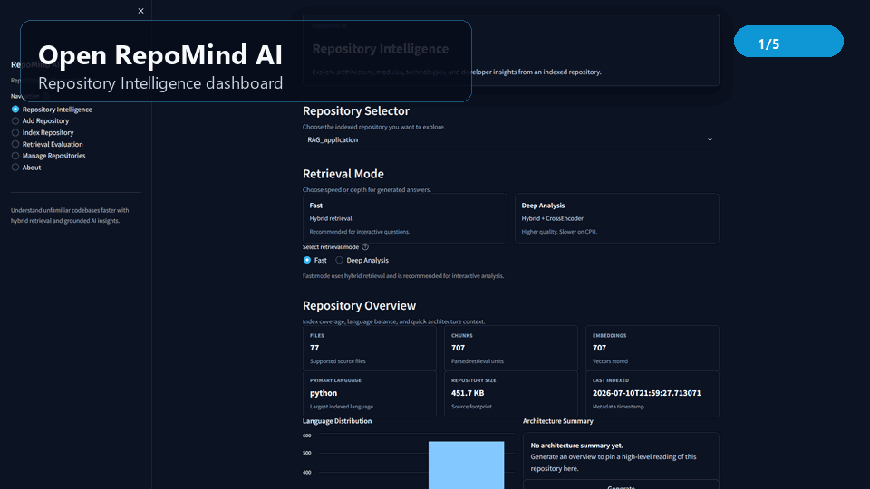

### Full Demo Video

[Watch on YouTube - placeholder](https://www.youtube.com/watch?v=YOUR_DEMO_VIDEO_ID)

[Demo video publishing placeholder](assets/demo/video_placeholder.md)

### Demo Assets

- [Demo video script](assets/demo/demo_video_script.md)
- [Recording guide](assets/demo/recording_guide.md)
- [Demo checklist](assets/demo/demo_checklist.md)

### Home

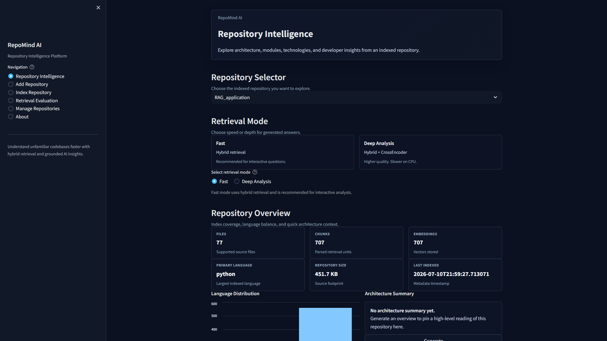

### Add Repository

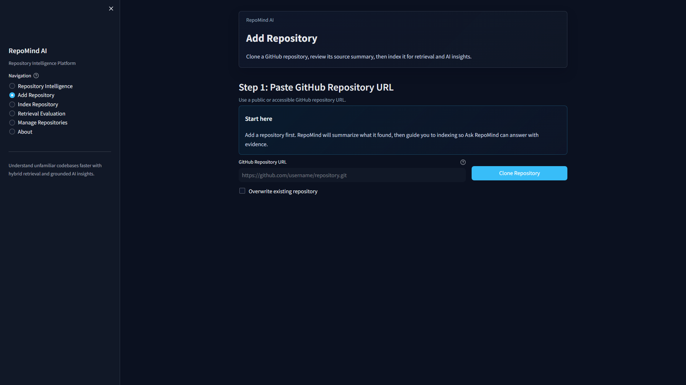

### Clone Success

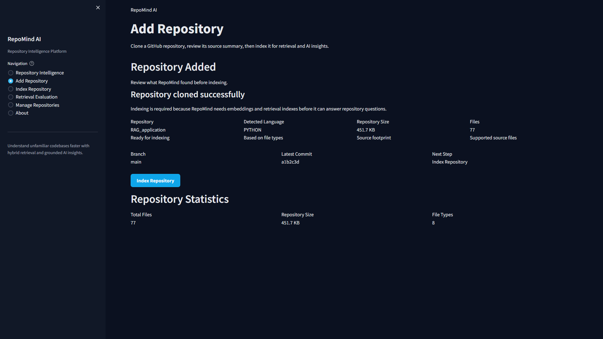

### Index Repository

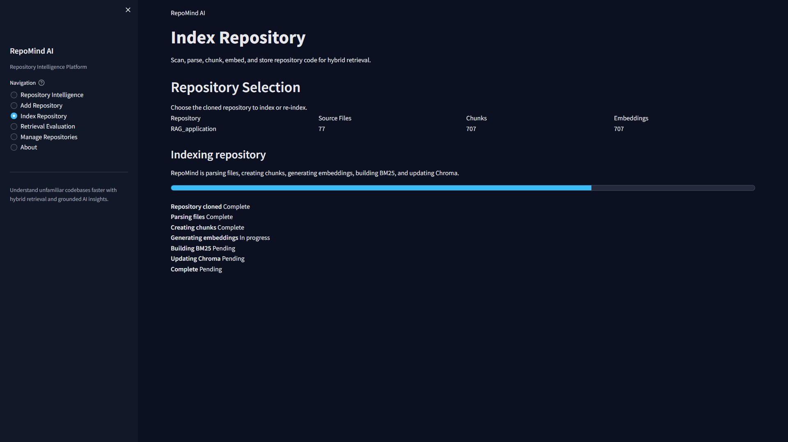

### Index Complete

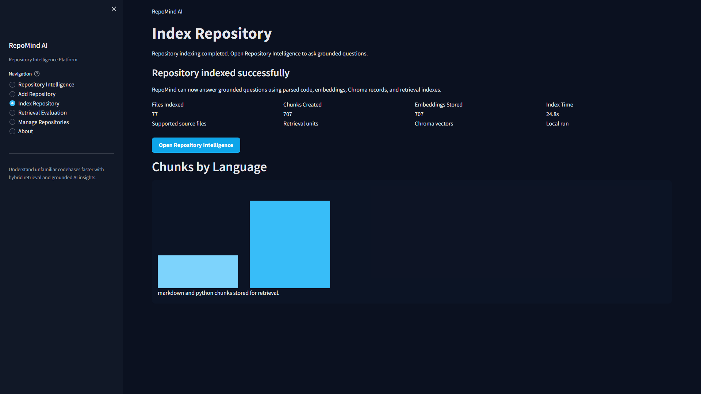

### Repository Intelligence

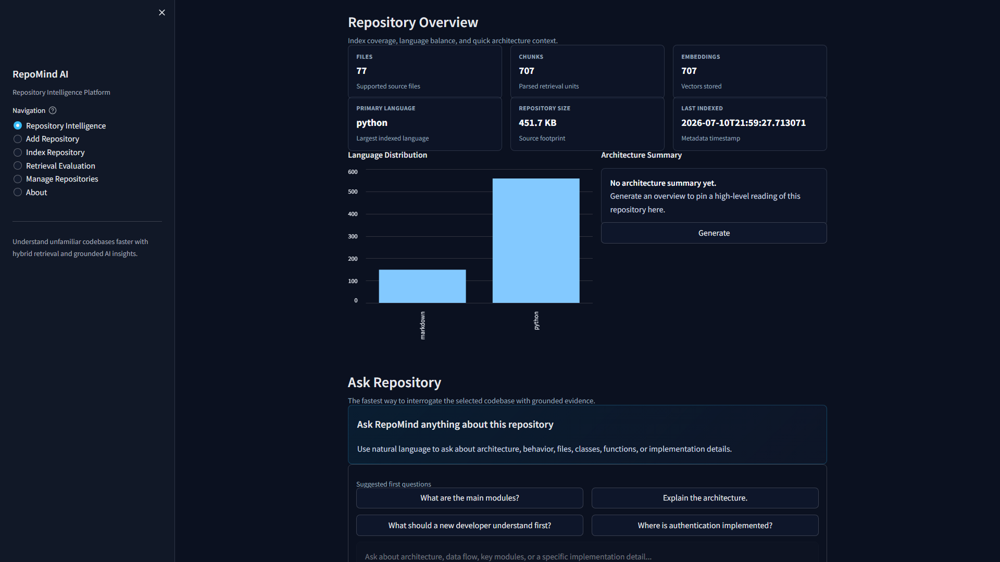

### Ask Repository

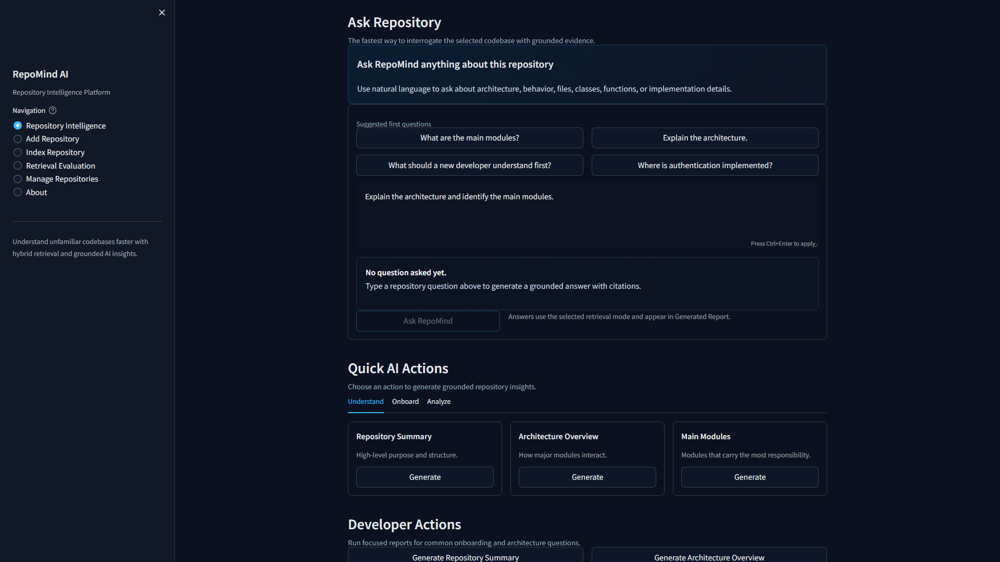

### Architecture Report

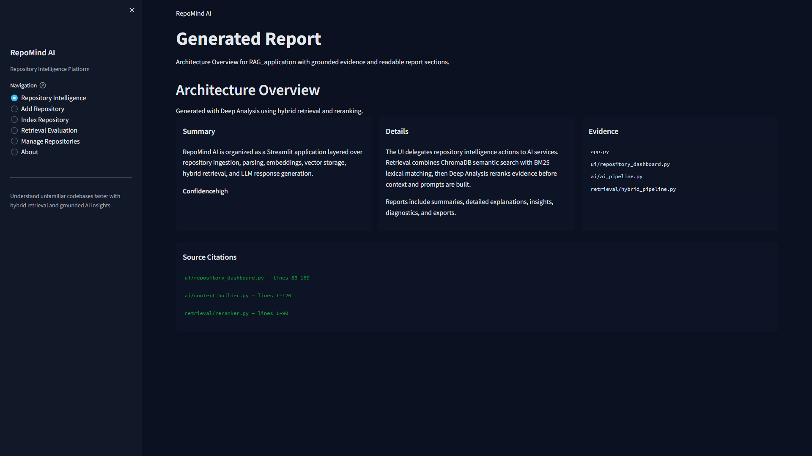

### Module Explorer

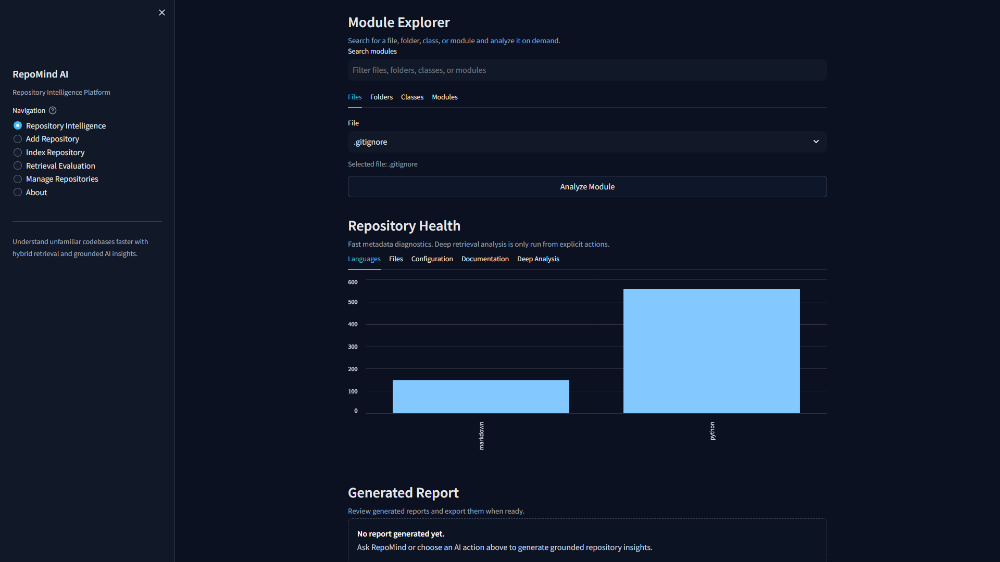

### Repository Health

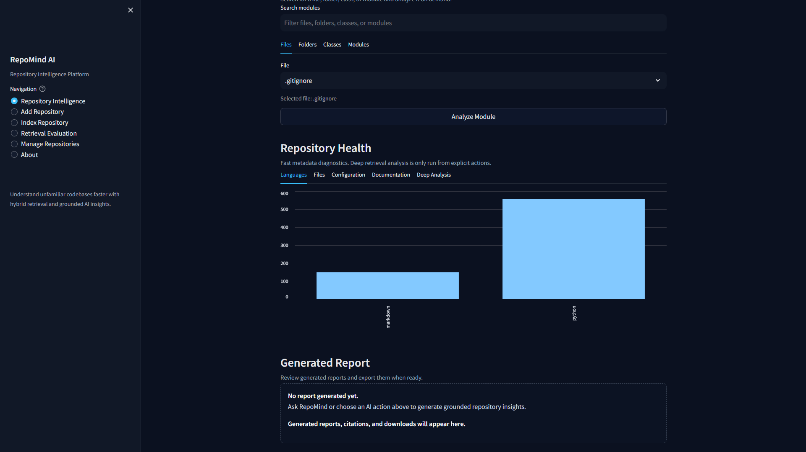

### Retrieval Evaluation

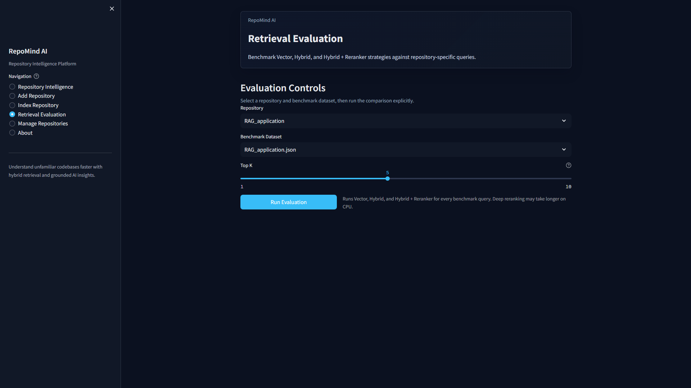

### Grounded Answer

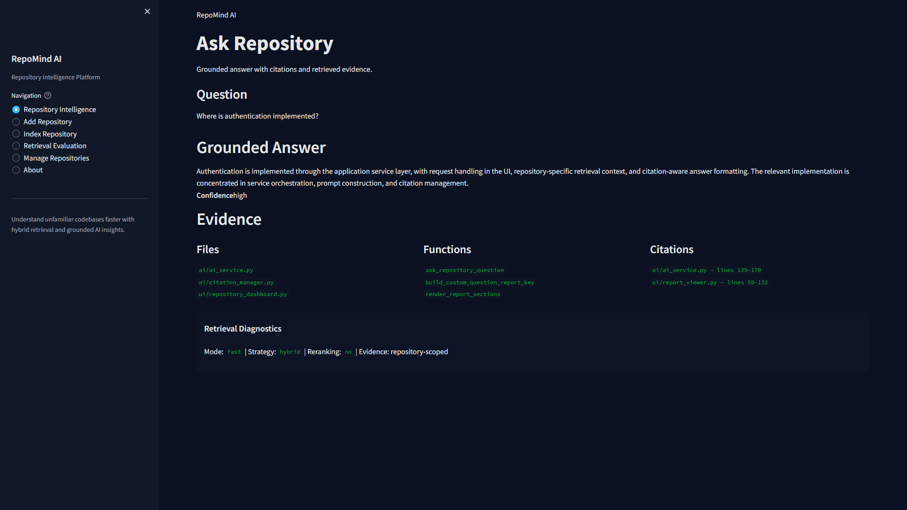

## System Architecture

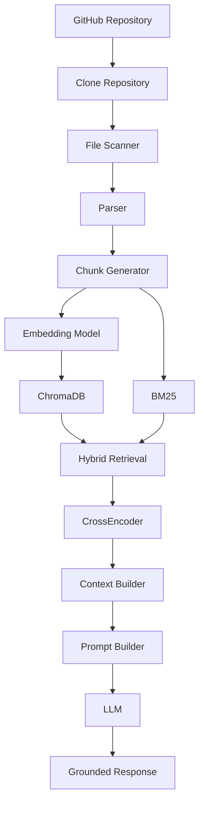

## RAG Pipeline

1. **Clone repository**  
   `github_loader.py` clones a GitHub repository into the local `repositories/` directory and stores repository metadata.

2. **Scan files**  
   `parser/file_scanner.py` finds supported source and documentation files while skipping ignored directories such as virtual environments, build folders, and vector storage.

3. **Parse source code**  
   Language-specific parsers in `parser/` extract file, class, function, and structure metadata where available.

4. **Create chunks**  
   Parsed content is converted into bounded chunks with repository, file, symbol, and line metadata.

5. **Generate embeddings**  
   `embedding/` uses SentenceTransformers to embed chunks for semantic retrieval.

6. **Store vectors**  
   `vectorstore/` persists repository-scoped embeddings in ChromaDB collections.

7. **Build lexical retrieval**  
   `retrieval/bm25_index.py` and `retrieval/bm25_retriever.py` support exact keyword and symbol matching.

8. **Fuse retrieval results**  
   `retrieval/hybrid_pipeline.py` combines vector and BM25 results, with routing, filtering, and score fusion.

9. **Rerank when needed**  
   Deep Analysis uses CrossEncoder reranking through `retrieval/reranker.py` for higher-quality evidence ordering.

10. **Build context and prompts**  
    `ai/context_builder.py` and `ai/prompt_builder.py` assemble repository-aware evidence for the selected LLM provider.

11. **Generate grounded answers**  
    `ai/ai_pipeline.py` produces summaries, detailed explanations, citations, warnings, and diagnostics.

## Tech Stack

| Technology | Purpose |
| --- | --- |
| Python | Core application language and orchestration. |
| Streamlit | Interactive web UI for repository ingestion, indexing, Q&A, reports, and evaluation. |
| SentenceTransformers | Local embedding generation for repository chunks. |
| ChromaDB | Persistent vector database for semantic retrieval. |
| Rank-BM25 | Lexical retrieval for exact terms, symbols, and file paths. |
| CrossEncoder | Optional reranking layer for Deep Analysis mode. |
| Groq | Supported LLM provider for fast hosted inference. |
| OpenAI | Supported LLM provider through the OpenAI SDK and LangChain integration. |
| GitPython | GitHub repository cloning, validation, and metadata access. |
| Markdown | Report formatting and export support. |
| Pytest | Regression, retrieval, parser, embedding, evaluation, and UI helper tests. |

## Project Structure

```text
RAG_application/
├── app.py                         # Main Streamlit application
├── config.py                      # Paths, model settings, retrieval settings, Streamlit config
├── github_loader.py               # GitHub cloning and repository management
├── utils.py                       # Shared utilities and metadata helpers
├── ai/                            # LLM providers, pipeline, context, prompts, citations, formatting
├── embedding/                     # Embedding service and model configuration
├── evaluation/                    # Retrieval evaluation, metrics, benchmark reports, dashboard
├── parser/                        # File scanner, chunk model, and language parsers
├── retrieval/                     # BM25, hybrid search, reranking, routing, filters, scoring
├── ui/                            # Streamlit UI components, dashboard, reports, module explorer
├── vectorstore/                   # ChromaDB collection and vector service management
├── tests/                         # Regression and smoke tests
├── repositories/                  # Local cloned repositories (runtime data)
├── vector_db/                     # Local ChromaDB persistence (runtime data)
├── requirements.txt               # Python dependencies
├── pytest.ini                     # Test configuration
├── DEVELOPMENT.md                 # Development notes
└── LICENSE                        # MIT License
```

## Installation

### Prerequisites

- Python 3.11 recommended
- Git
- A Groq or OpenAI API key for LLM-generated answers and reports

### 1. Clone the repository

```bash
git clone https://github.com/your-username/RAG_application.git
cd RAG_application
```

### 2. Create a virtual environment

Windows:

```powershell
python -m venv .venv
.\.venv\Scripts\activate
```

macOS/Linux:

```bash
python3 -m venv .venv
source .venv/bin/activate
```

### 3. Install dependencies

```bash
pip install -r requirements.txt
```

### 4. Configure environment variables

Create a `.env` file in the project root:

```env
# Choose one provider or configure both.
GROQ_API_KEY=your_groq_api_key
OPENAI_API_KEY=your_openai_api_key

# Optional provider/model overrides.
LLM_PROVIDER=groq
GROQ_MODEL=mixtral-8x7b-32768
OPENAI_MODEL=gpt-4o-mini
```

### 5. Launch Streamlit

```bash
streamlit run app.py
```

Open the app at:

```text
http://localhost:8501
```

## Usage

1. **Add Repository**  
   Paste a GitHub repository URL and clone it locally.

2. **Index Repository**  
   Parse files, create chunks, generate embeddings, update ChromaDB, and prepare retrieval indexes.

3. **Select Repository**  
   Open Repository Intelligence and choose the indexed repository you want to analyze.

4. **Ask Questions**  
   Use Ask RepoMind for repository-specific Q&A in Fast Mode or Deep Analysis mode.

5. **Generate Reports**  
   Create repository summaries, architecture overviews, onboarding guides, module explanations, and learning paths.

6. **Export Reports**  
   Download generated reports as Markdown, JSON, or PDF.

## Example Questions

- How is authentication implemented?
- Explain the repository architecture.
- Where is JWT validation handled?
- Which modules communicate with the database?
- How is face recognition implemented?
- Generate an onboarding guide.
- What are the main modules and responsibilities?
- Which files should a new developer read first?

## Performance

RepoMind AI supports two retrieval modes:

| Mode | Retrieval behavior | Best for |
| --- | --- | --- |
| Fast Mode | Hybrid retrieval with semantic vectors and BM25 lexical search. | Interactive repository Q&A and quick exploration. |
| Deep Analysis | Hybrid retrieval plus CrossEncoder reranking. | Higher-quality answers for architecture, onboarding, and complex implementation questions. |

The retrieval stack is designed to balance speed, precision, and grounding:

- **Hybrid Retrieval** combines embeddings with exact-match BM25 signals.
- **CrossEncoder reranking** improves evidence ordering when Deep Analysis is selected.
- **Repository isolation** keeps retrieval scoped to the selected repository.
- **Grounded citations** connect answers back to files, functions, classes, and line metadata.

No benchmark numbers are claimed here; use the Retrieval Evaluation page and `evaluation/` utilities to measure retrieval quality on your own repositories.

## Project Highlights

- Multi-repository isolation across metadata, vector collections, retrieval, and reports.
- Hybrid retrieval using ChromaDB vector search plus BM25 lexical search.
- Deep Analysis mode with CrossEncoder reranking.
- Repository-aware context building for grounded LLM responses.
- Citation-aware answers with referenced files, classes, functions, and diagnostics.
- Streamlit workflows for cloning, indexing, asking questions, generating reports, and exporting results.
- Retrieval evaluation tooling for quality checks and benchmark reporting.
- Developer-focused outputs: architecture summaries, onboarding guides, module explanations, and learning paths.

## Future Roadmap

- [ ] Conversation history across sessions
- [x] Repository Q&A
- [x] Hybrid Retrieval
- [x] Multi-repository support
- [x] Architecture Reports
- [ ] Cloud deployment
- [ ] Multi-user authentication
- [ ] Docker packaging
- [ ] Screenshot-backed documentation
- [ ] Repository comparison reports

## Contributing

Contributions are welcome. To propose a change:

1. Fork the repository.
2. Create a branch for your change.
3. Keep retrieval, indexing, and UI behavior covered by tests where applicable.
4. Run the regression suite before opening a pull request.
5. Open a pull request with a clear summary, screenshots for UI changes, and validation notes.

Local test command:

```bash
pytest
```

## License

This project is licensed under the MIT License. See [LICENSE](LICENSE) for details.

## Acknowledgements

RepoMind AI builds on excellent open-source tools and ecosystems:

- [Streamlit](https://streamlit.io/) for the interactive application framework.
- [ChromaDB](https://www.trychroma.com/) for vector persistence.
- [SentenceTransformers](https://www.sbert.net/) for embedding models.
- [rank-bm25](https://pypi.org/project/rank-bm25/) for lexical retrieval.
- [GitPython](https://gitpython.readthedocs.io/) for repository operations.
- [LangChain](https://www.langchain.com/) for LLM integration utilities.
- [Groq](https://groq.com/) and [OpenAI](https://openai.com/) for LLM provider support.
- [Pytest](https://docs.pytest.org/) for regression testing.
